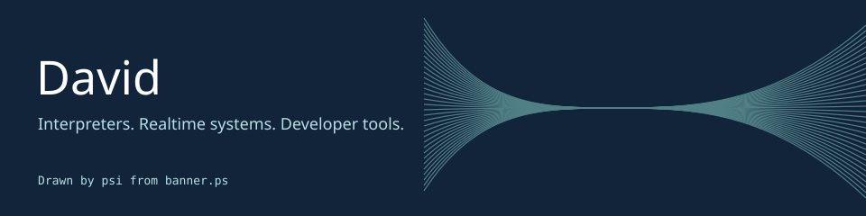

I build tools that make complex systems easier to work with.

<table>
<tr><td width="50%">

### [psi](https://github.com/ddelvalfraire/postscript-interpreter)
An interactive PostScript interpreter with a live stack and dictionary view.
The banner above is output from its interpreter engine. [Read the program](banner.ps).

</td><td width="50%">

### [Quanta](https://github.com/ddelvalfraire/Quanta)
A multiplayer platform for realtime browser apps, built with Rust, Elixir, and TypeScript.
Particle-world and a collaborative editor explore the same protocol.

</td></tr><tr><td>

### [etrpc](https://github.com/ddelvalfraire/etrpc)
Type-safe RPC for Electron, with queries, mutations, and streaming subscriptions.

</td><td>

### [Parakeet](https://github.com/ddelvalfraire/parakeet)
AI incident response built on Amazon Nova.

</td></tr><tr><td>

### [mygit](https://github.com/ddelvalfraire/mygit)
Git-like version control written in C.

</td><td>

### [interpreter](https://github.com/ddelvalfraire/interpreter)
An interpreter and REPL for a custom language, written in Go.

</td></tr></table>

### On the bench

These are real checks of fixed project revisions, refreshed nightly when Actions runs.
The timestamp below is the last attempt, not a promise of current health.
Quanta checks cover its Rust core only, not browser demos, deployment, or scale.
Its particle demo needs a separate WASM build; see the project's setup instructions.

#### psi: PASS

Revision: `e949359257e49c6ac54d2c33076bd9b21ee44c97`

2026-11-10T17:10:24.571505+00:00: exit 0, 0.004s

<pre>$ git init -q
</pre>

2026-11-10T17:10:24.575519+00:00: exit 0, 0.816s

<pre>$ git fetch --depth=1 https://github.com/ddelvalfraire/postscript-interpreter.git e949359257e49c6ac54d2c33076bd9b21ee44c97
From https://github.com/ddelvalfraire/postscript-interpreter
 * branch            e949359257e49c6ac54d2c33076bd9b21ee44c97 -&gt; FETCH_HEAD</pre>

2026-11-10T17:10:25.391735+00:00: exit 0, 0.032s

<pre>$ git checkout --detach FETCH_HEAD
HEAD is now at e949359 docs: add development section and fix markdownlint warnings</pre>

2026-11-10T17:10:25.423842+00:00: exit 0, 0.004s

<pre>$ bun --version
1.4.4</pre>

2026-11-10T17:10:25.428142+00:00: exit 0, 0.265s

<pre>$ bun install --frozen-lockfile --ignore-scripts
bun install v1.4.4 (38afee6c8)

37 packages installed [222.00ms]</pre>

2026-11-10T17:10:25.693134+00:00: exit 0, 0.115s

<pre>$ bun test
(pass) false &gt; pushes boolean false [0.05ms]
(pass) false &gt; used in expression [0.04ms]
(pass) cause chaining &gt; eq on empty stack chains stackunderflow [0.05ms]
(pass) cause chaining &gt; not on empty stack chains stackunderflow [0.05ms]
(pass) cause chaining &gt; real(0) is still a number, not equal to int(0) as cross-type [0.05ms]

::endgroup::

 737 pass
 0 fail
 1050 expect() calls
Ran 737 tests across 21 files. [102.00ms]</pre>

2026-11-10T17:10:25.807919+00:00: exit 0, 0.065s

<pre>$ bun run packages/interpreter/profile-render.ts banner.ps
 C 590 40
 750 200
 960 40
&quot;/&gt;&lt;path d=&quot;M 470 206
 C 590 34
 750 206
 960 34
&quot;/&gt;&lt;path d=&quot;M 470 212
 C 590 28
 750 212
 960 28
&quot;/&gt;&lt;/g&gt;&lt;text x=&quot;40&quot; y=&quot;105&quot; fill=&quot;#ffffff&quot; font-family=&quot;sans-serif&quot; font-size=&quot;52&quot;&gt;David&lt;/text&gt;&lt;text x=&quot;42&quot; y=&quot;144&quot; fill=&quot;#b8dfe4&quot; font-family=&quot;sans-serif&quot; font-size=&quot;18&quot;&gt;Interpreters. Realtime systems. Developer tools.&lt;/text&gt;&lt;text x=&quot;42&quot; y=&quot;205&quot; fill=&quot;#b8dfe4&quot; font-family=&quot;monospace&quot; font-size=&quot;13&quot;&gt;Drawn by psi from banner.ps&lt;/text&gt;&lt;/svg&gt;</pre>

#### Quanta: PASS

Revision: `2e0076e4ca40224f21c388ac471b1d92507c9519`

2026-11-10T17:10:25.910762+00:00: exit 0, 0.008s

<pre>$ git init -q
</pre>

2026-11-10T17:10:25.918605+00:00: exit 0, 0.666s

<pre>$ git fetch --depth=1 https://github.com/ddelvalfraire/Quanta.git 2e0076e4ca40224f21c388ac471b1d92507c9519
From https://github.com/ddelvalfraire/Quanta
 * branch            2e0076e4ca40224f21c388ac471b1d92507c9519 -&gt; FETCH_HEAD</pre>

2026-11-10T17:10:26.584260+00:00: exit 0, 0.215s

<pre>$ git checkout --detach FETCH_HEAD
HEAD is now at 2e0076e docs: humanize README and drop schema-drift section (#54)</pre>

2026-11-10T17:10:26.798804+00:00: exit 0, 0.016s

<pre>$ cargo --version
cargo 1.99.1 (5f94df478 2026-08-27)</pre>

2026-11-10T17:10:26.814835+00:00: exit 0, 0.016s

<pre>$ rustc --version
rustc 1.99.1 (58cf8f9c3 2026-10-13)</pre>

2026-11-10T17:10:26.830732+00:00: exit 0, 25.686s

<pre>$ cargo test --locked -p quanta-core-rs
test slo_apply_delta_20f ... ignored
test slo_compile_schema_50f ... ignored
test slo_compute_delta_20f_50pct ... ignored

test result: ok. 0 passed; 0 failed; 3 ignored; 0 measured; 0 filtered out; finished in 0.00s

   Doc-tests quanta_core_rs

running 0 tests

test result: ok. 0 passed; 0 failed; 0 ignored; 0 measured; 0 filtered out; finished in 0.00s
</pre>

[How checks run and what they miss](MAINTENANCE.md).
