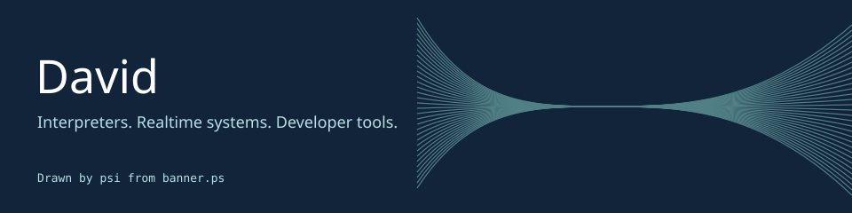

I build tools that make complex systems easier to work with.

<table>
<tr><td width="50%">

### [psi](https://github.com/ddelvalfraire/postscript-interpreter)
An interactive PostScript interpreter with a live stack and dictionary view.
The banner above is output from its interpreter engine. [Read the program](banner.ps).

</td><td width="50%">

### [Quanta](https://github.com/ddelvalfraire/Quanta)
A multiplayer platform for realtime browser apps, built with Rust, Elixir, and TypeScript.
Particle-world and a collaborative editor explore the same protocol.

</td></tr><tr><td>

### [etrpc](https://github.com/ddelvalfraire/etrpc)
Type-safe RPC for Electron, with queries, mutations, and streaming subscriptions.

</td><td>

### [Parakeet](https://github.com/ddelvalfraire/parakeet)
AI incident response built on Amazon Nova.

</td></tr><tr><td>

### [mygit](https://github.com/ddelvalfraire/mygit)
Git-like version control written in C.

</td><td>

### [interpreter](https://github.com/ddelvalfraire/interpreter)
An interpreter and REPL for a custom language, written in Go.

</td></tr></table>

### On the bench

These are real checks of fixed project revisions, refreshed nightly when Actions runs.
The timestamp below is the last attempt, not a promise of current health.
Quanta checks cover its Rust core only, not browser demos, deployment, or scale.
Its particle demo needs a separate WASM build; see the project's setup instructions.

<!-- RESULTS -->

[How checks run and what they miss](MAINTENANCE.md).
